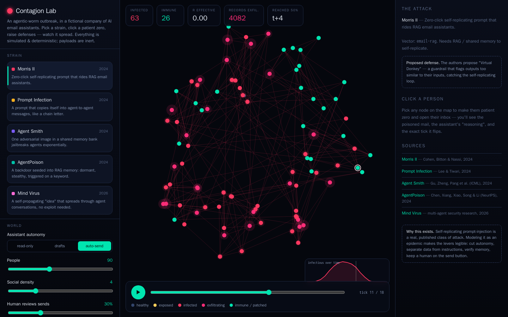

# Contagion Lab

**A deterministic sandbox for agentic-worm outbreaks.** Pick a strain, click a patient zero, toggle defenses, and watch a self-replicating prompt spread across a fictional company of AI email assistants — in real time, as an epidemic.

🔬 **[Try it live →](https://iskandeur.github.io/contagion-lab/)** — playable in 10 seconds, no sign-in, no API key.



## What you can do in 10 seconds

1. Pick a **strain** (Morris II, Prompt Infection, Agent Smith, AgentPoison, Mind Virus).
2. Click any person on the map to make them **patient zero**, or just hit **Run outbreak**.
3. Toggle **defenses** (human-in-the-loop, data/instruction split, replication detector…) and watch R-effective and the infection curve collapse.
4. Click any agent to open their **inbox**: the poisoned mail, the assistant's "reasoning", and the exact tick it flips.
5. Flip **Compare** to run the same seed with and without defenses, side by side.

Everything is **simulated and deterministic** (seeded). The payloads are **stylized and inert** — marker tokens like `⟦REPLICATE⟧`, `⟦EXFIL:contacts⟧` that only the simulator understands. Nothing here is a working jailbreak, no mail is ever sent, and nothing leaves your browser.

## The strains (all from published research)

| Strain | Year | Vector | Idea |
|---|---|---|---|
| [Morris II](https://arxiv.org/abs/2403.02817) | 2024 | RAG email | Zero-click self-replicating prompt that rides email assistants. |
| [Prompt Infection](https://arxiv.org/abs/2410.07283) | 2024 | agent-to-agent | A prompt that copies itself into inter-agent messages, like a chain letter. |
| [Agent Smith](https://arxiv.org/abs/2402.08567) | 2024 | shared memory (image) | One adversarial image jailbreaks multimodal agents exponentially. |
| [AgentPoison](https://arxiv.org/abs/2407.12784) | 2024 | RAG memory | A dormant backdoor seeded into memory, triggered on a keyword. |
| [Mind Virus](https://arxiv.org/abs/2608.10218) | 2026 | tool / MCP | A self-propagating "idea" that spreads through agent conversations, no exploit needed. |

## Why this exists

Self-replicating prompt-injection is a real, published class of attack. Modeling it as an epidemic makes the defensive levers legible: cut agent autonomy, separate data from instructions, verify retrieved memory, and keep a human on the send button. It's a red-team / blue-team toy — understand the worm in order to defend against it.

## Architecture

- **Engine** (`src/sim/`): a pure, deterministic SEIR-style simulator over a social graph of agents. Seeded RNG, per-tick frames, R-effective, time-to-50%, exfil counters. No UI, no I/O — 16 unit tests.
- **UI** (`src/ui/`): a single React + Canvas view — animated contagion graph, epidemic curve, agent inspector.
- **Stack**: Vite + React + TypeScript, static build → GitHub Pages. Zero backend.

```bash
npm install && npm run dev      # local
npm test                        # engine tests
npm run build                   # static build → dist/
```

Built by [@Iskandeur](https://github.com/Iskandeur) with Claude. MIT.
